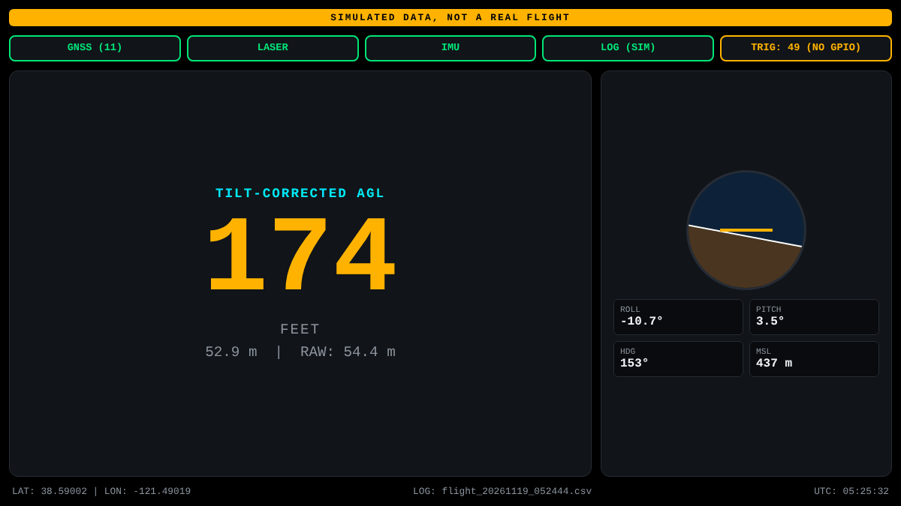
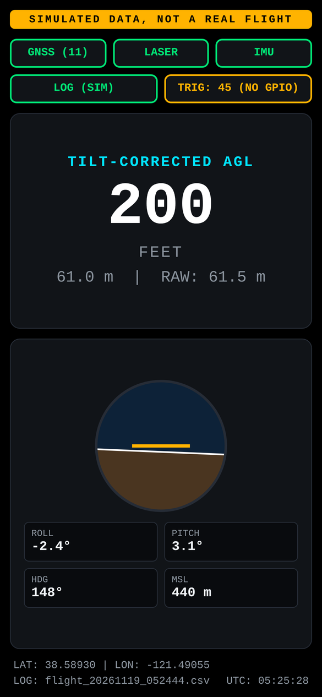
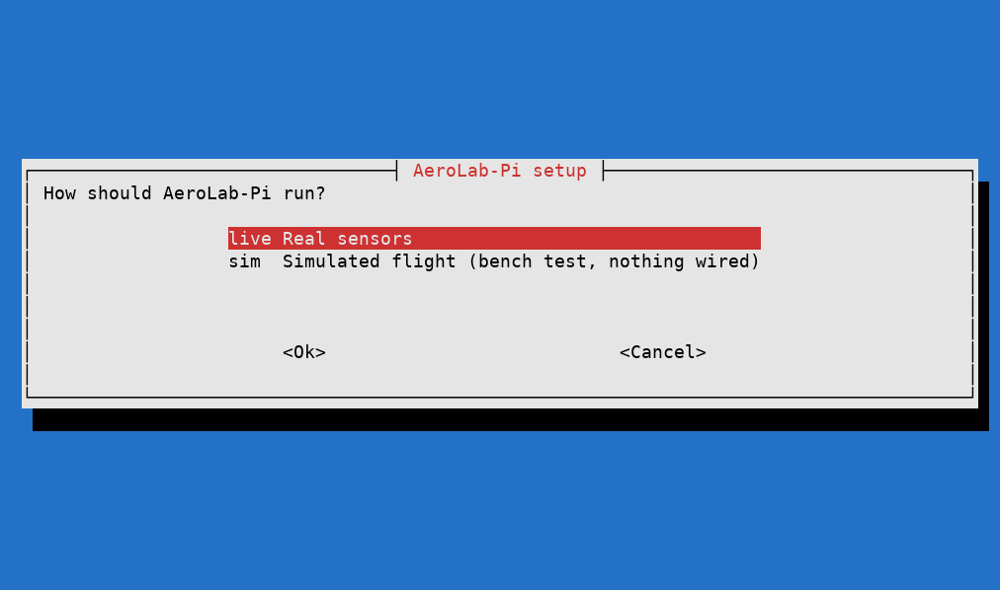
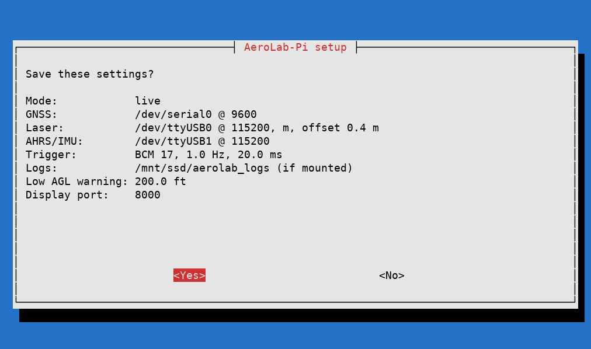

# AeroLab-Pi

A Raspberry Pi telemetry logger and offline cockpit display for small-aircraft science payloads: laser altimeter, GNSS, AHRS/IMU, and a hardware trigger for a snow radar or multispectral camera.

The Pi reads the sensors, works out height above ground corrected for bank and pitch, logs everything to disk, and serves a display page over its own Wi-Fi. Any phone or iPad in the cockpit can open it. No internet needed.



*The cockpit display in simulation mode, recorded from `daemon/main.py --sim`. Every number is simulated.*

> **Not certified avionics.** The AGL readout is an advisory number for running the science payload. Do not use it for navigation, terrain clearance, or any flight decision.

## What it does

- **Tilt-corrected AGL.** A laser fixed to the airframe measures slant range when the aircraft banks. The daemon reports the vertical part, `range × cos(pitch) × cos(roll) − mounting offset`, in feet and metres.
- **Cockpit display.** One dark, high-contrast page: AGL in large digits (amber below 200 ft, configurable), an attitude ball, heading, MSL, position, and a status pill for each sensor. A sensor that stops talking for 2 seconds goes red and its numbers show `---` instead of freezing.
- **Logs that survive a power cut.** Every sample goes to SQLite (WAL mode) and to a CSV file that is fsynced after each row and rotated every 5 minutes. Pulling the power loses at most the last fraction of a second.
- **Geotagged payload triggers.** A GPIO pulse at a fixed rate (1 Hz default) tells the radar/camera to capture, and the position, AGL, and attitude at that instant go into the `payload_triggers` table.
- **Simulation mode.** `--sim` makes up a plausible flight so you can test the display, the maths, and the logger on a laptop with nothing wired.

## Screens

| iPad, landscape | Below the low-AGL line (amber) | Phone |
|---|---|---|
|  |  |  |

The green pills are sensor health; each turns red if that sensor goes quiet for 2 seconds. `TRIG` counts payload trigger pulses and shows `NO GPIO` in amber when no pin is being driven, as on a laptop or in simulation.

## Try it on a laptop (no hardware)

Needs Python 3.10 or newer.

```bash
git clone https://github.com/craigm26/aerolab-pi.git
cd aerolab-pi
python3 -m venv .venv
.venv/bin/pip install -r requirements.txt
.venv/bin/python daemon/main.py --sim
```

Open <http://localhost:8000>. A yellow strip across the top says the data is simulated. Sim logs go to `logs/sim/` and never mix with flight logs.

## Install on the Raspberry Pi

Target: Raspberry Pi OS (Bookworm or newer), any Pi from the 3B+ to the Pi 5.

```bash
git clone https://github.com/craigm26/aerolab-pi.git
cd aerolab-pi
./install.sh             # asks setup questions with menus
# or
./install.sh --sim       # no questions; simulated sensors, to bench-test the box before the sensors arrive
./install.sh --defaults  # no questions; uses config/sensors.yaml as is
```

### Setup menus

`./install.sh` asks its questions with arrow-key menus, the same kind `raspi-config` uses:

| | |
|---|---|
|  |  |

It asks for:

- **live or simulated** sensors,
- for each sensor, the **serial port**, picked from the ports plugged in at that moment (USB adapters are saved by their stable `/dev/serial/by-id/` name so two adapters can't swap on reboot), and the **baud rate**,
- the laser's **unit** (m or cm) and **mounting offset**,
- the **trigger pin**, pulse rate and pulse width, or no trigger,
- where the **USB SSD** is mounted,
- the **low-AGL warning** height and the display's web port,
- whether to make the Pi a **Wi-Fi hotspot** for the cockpit display (default no, since it drops a Wi-Fi SSH session).

Plug the sensors in before running it so they show up in the lists. Esc quits without saving. The answers go to `config/sensors.local.yaml`, which git ignores, so `git pull` never overwrites them. Change them any time with:

```bash
./configure.sh     # same menus, then restarts the service
```

Over a connection with no terminal the installer skips the menus and uses the defaults. `python scripts/configure.py --plain` asks the same questions as plain text prompts.

### What the installer does

The installer:

1. installs Python and the GPIO libraries (`gpiozero` + `lgpio`, which work on the Pi 5; `RPi.GPIO` does not),
2. creates `.venv` and installs the requirements,
3. adds your user to the `dialout` and `gpio` groups,
4. frees the hardware UART for the GNSS (serial console off, serial port on),
5. asks the setup questions above,
6. installs and starts the `aerolab` systemd service, which starts on boot and restarts within 2 seconds if it ever stops.

Reboot once afterwards so the serial and group changes take effect. Then:

```bash
journalctl -u aerolab -f     # live log: which ports opened, any sensor errors
curl localhost:8000/api/state  # current numbers as JSON
```

To update later: `git pull && ./install.sh`.

## Wiring and configuration

`./configure.sh` covers the usual settings. Everything else is in `config/sensors.local.yaml` (your copy) and `config/sensors.yaml` (the defaults). Edit your copy, then `sudo systemctl restart aerolab`.

| Sensor | Default port | What it must send |
|---|---|---|
| GNSS | `/dev/serial0` (GPIO 14/15 UART) or `/dev/ttyACM0` (USB) | NMEA 0183; `GGA` sentences are used |
| Laser altimeter | `/dev/ttyUSB0` | One reading per line; the first number is the range. Set `unit: "cm"` if it reports centimetres |
| AHRS/IMU | `/dev/ttyUSB1` | `roll,pitch,yaw` in degrees, one line per reading |
| Payload trigger | GPIO 17 (BCM) | 3.3 V pulse, 20 ms wide, 1 Hz |

Measure `mounting_offset_m`: the vertical distance from the laser lens down to the lowest point of the aircraft (wheels or belly). With the aircraft on the ground the display should read 0.

The setup menus save USB adapters by their stable `/dev/serial/by-id/...` names. If you edit the file by hand, use those names too rather than `ttyUSB0`/`ttyUSB1`, which can swap on reboot. `ls /dev/serial/by-id/` lists them.

The parsers are generic. Specific models (LightWare SF11/c, Garmin LIDAR-Lite, u-blox ZED-F9P, VectorNav, BNO085 and so on) may need a small driver change in `daemon/main.py` (`parse_laser_line`, `parse_imu_line`).

## Before flight

1. **Logs on a USB SSD.** Mount it at `/mnt/ssd` (add it to `/etc/fstab` with `nofail`). The daemon uses `/mnt/ssd/aerolab_logs` only when `/mnt/ssd` is really mounted. Otherwise it logs to `./logs` on the SD card. The display footer shows the current log file, and `log_dir` in `/api/state` shows where it is.
2. **Wi-Fi hotspot for the cockpit display.** `./configure.sh` offers to set it up. To do it by hand, pick your own password:
   ```bash
   sudo nmcli con add type wifi ifname wlan0 con-name AeroLab-HUD autoconnect yes \
     ssid AeroLab-HUD mode ap ipv4.method shared \
     wifi-sec.key-mgmt wpa-psk wifi-sec.psk 'choose-a-password'
   sudo nmcli con up AeroLab-HUD
   ```
   Then join `AeroLab-HUD` from the iPad and open `http://10.42.0.1:8000`. On iOS, "Add to Home Screen" gives a full-screen display.
3. **Read-only SD card, last.** Once everything works, turn on the overlay filesystem (`sudo raspi-config` → Performance Options → Overlay File System) so a hard power switch can't corrupt the SD card. With the overlay on, **anything written to the SD card is lost at power-off**, so the SSD from step 1 is required. Turn the overlay off again before running `git pull` or `./install.sh`.

## Aircraft safety

- **Power isolation.** Run the Pi and payload from their own LiFePO4 pack or an isolated, fused DC-DC converter. Never splice into the aircraft's avionics bus.
- **Not avionics.** See the note at the top.

## Data

Both stores sit in the log directory.

- `aerolab_flight.db`, table `telemetry`: every sample at `log_hz` (5 Hz default), including per-sensor health flags.
- `aerolab_flight.db`, table `payload_triggers`: one row per trigger pulse. `trigger_id` restarts at 1 every boot; `session_start` tells boots apart.
- `flight_YYYYMMDD_HHMMSS.csv`: the same samples as `telemetry`, one file per 5 minutes, times in UTC.

The Pi has no battery-backed clock (the Pi 5 has one only with a coin cell fitted), so without internet the system time can be wrong at boot. The GNSS time is in the NMEA stream but is not yet used to set the clock.

## Development

```bash
.venv/bin/pip install -r requirements-dev.txt
.venv/bin/python -m pytest
```

The tests cover the setup menus (port discovery, answer checking, the file they write), the AGL maths, the serial parsers (including blank and garbled lines), log directory selection, and a short simulated flight that checks the web page, the JSON and WebSocket feeds, and both log stores.
