# AeroLab-Pi

A Raspberry Pi telemetry logger and offline cockpit display for small-aircraft science payloads: laser altimeter, GNSS or GNSS/INS, attitude sensor, and a trigger for cameras and radars.

The Pi reads the sensors, works out height above ground corrected for bank and pitch, logs everything to disk, and serves a display page over its own Wi-Fi. Any phone or iPad in the cockpit can open it. No internet needed.

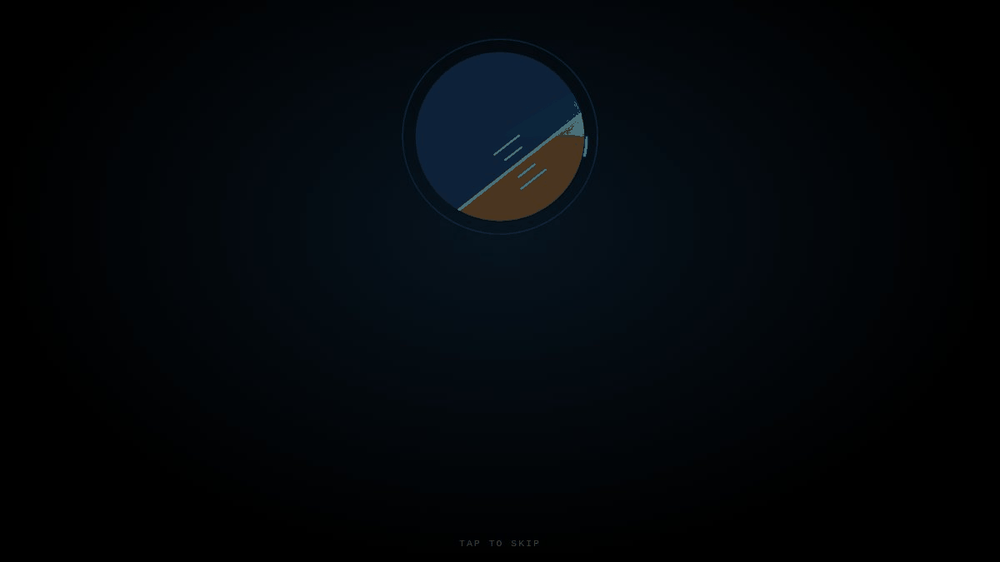

*Startup: the display checks each sensor off as its data arrives, then hands over. Recorded from simulation mode.*

**Demo video (2 min 19 s):** [docs/aerolab-demo.mp4](docs/aerolab-demo.mp4). Setup, boot self-test, ground calibration, flight, callouts, Buddy and the accuracy results, all recorded from the running code in simulation mode.

[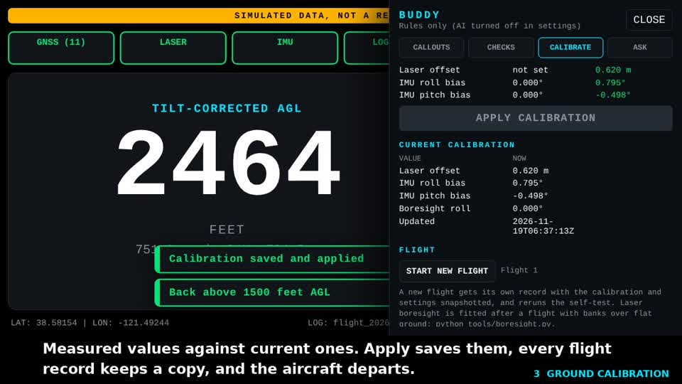](docs/aerolab-demo.mp4)

> **Not certified avionics.** The AGL readout is an advisory number for running the science payload. Do not use it for navigation, terrain clearance, or any flight decision.

## What it does

- **Tilt-corrected AGL.** A laser fixed to the airframe measures slant range when the aircraft banks. The daemon reports the vertical part, `range × cos(pitch) × cos(roll) − mounting offset`, in feet and metres.
- **Hardware presets.** Pick your laser, GNSS/INS, attitude sensor and payloads from a catalog of common science hardware, or start from a whole-aircraft profile. Each preset carries the right driver, baud rate and protocol quirks.
- **Cockpit display.** AGL in large digits (amber below a height you choose), attitude ball, heading, altitude, position, and a status pill per sensor. A sensor that goes quiet for 2 seconds turns red and shows `---` instead of a frozen number.
- **Buddy.** Callouts when something changes (sensor lost or back, GNSS fix, low AGL, logging, disk, heat, power), optionally spoken aloud. A preflight ground check. Questions answered from the Pi's own data, with an optional local AI model.
- **Logs that survive a power cut.** Every sample goes to SQLite (WAL mode) and to a CSV file fsynced after each row and rotated every 5 minutes.
- **Geotagged payload triggers.** A GPIO pulse (or an HTTP capture request) at a fixed rate, with position, AGL and attitude logged at each one.
- **Accuracy you can check.** A self-test at every boot, a ground calibration before each flight, integrity checks every second in flight, a boresight fit after flight, and virtual flights against known truth in the test suite. See [Accuracy](#accuracy-testing-and-calibration).
- **Simulation mode.** A made-up flight at your planned survey height, so the display, maths, logs and Buddy can be tested with nothing wired.

## Screens


| iPad, landscape | Below the low-AGL line (amber) | Phone |
|---|---|---|
| 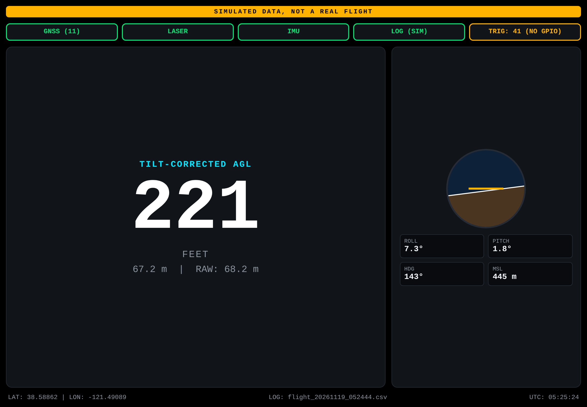 | 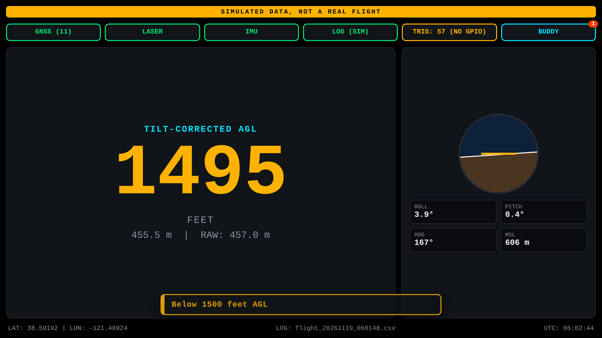 |  |

All screenshots are from simulation mode with the airborne snow survey profile. The yellow strip says so on screen.

## Hardware presets

`config/hardware.yaml` lists the supported devices. `./configure.sh` offers them in menus, and `python scripts/configure.py --list` prints them.

| Kind | Devices |
|---|---|
| Laser altimeters | Riegl LD90-3800, Jenoptik/ASTECH LDM301, LightWare GRF-500, SF11/C, LW20/C, Benewake TF03-180, TF02-Pro, generic ASCII (m or cm) |
| GNSS and GNSS/INS | u-blox ZED-F9P, NEO-M9N, NEO-M8N, Septentrio mosaic-X5, NovAtel OEM7, VectorNav VN-200, VN-300, SBG Ellipse-N/D, Applanix APX-15, ArduPilot/PX4 over MAVLink, generic NMEA |
| Attitude | From the GNSS/INS, VectorNav VN-100, BNO085/086 (UART-RVC), SBG Ellipse-A, MAVLink, generic `roll,pitch,yaw` lines |
| Payloads | CReSIS/KU 2-8 GHz snow radar, MicaSense Altum-PT/RedEdge-P (trigger pin or HTTP capture), Sentera 6X, generic 3.3 V trigger |

Every entry records where its protocol details come from:

- **manual**: the vendor manual or datasheet.
- **secondary**: well-used open-source drivers (ArduPilot, PX4) or distributor documents.
- **unverified**: the format is not confirmed. That covers the Riegl LD90 range block, the LDM301 line format and the VN-300 and APX-15 defaults.

None of these has been flown with AeroLab-Pi yet. Check each sensor on the bench with the ground check before it goes on an aircraft.

### Laser range is the hard part

Most affordable lasers stop far short of survey heights:

| Laser | Rated range | Height that is |
|---|---|---|
| Benewake TF02-Pro | about 40 m | 130 ft |
| LightWare LW20/C | 100 m | 330 ft |
| LightWare SF11/C | 120 m | 390 ft |
| Benewake TF03-180 | 180 m (90% target), 70 m (10%) | 590 ft |
| Jenoptik LDM301 | 300 m natural surfaces | 980 ft |
| LightWare GRF-500 | 500 m (40% albedo) | 1,640 ft |
| Riegl LD90-3800 | 2,500 m max | 8,200 ft |

Snow and ice reflect well, but fresh snow at a shallow angle, glassy ice and open water can return almost nothing. Setup asks for the planned survey height and warns when the chosen laser can't reach it.

### Profiles

| Profile | GNSS | Attitude | Laser | Payloads |
|---|---|---|---|---|
| **Airborne snow survey** (default) | VectorNav VN-200 | from the VN-200 | Riegl LD90-3800 | snow radar, MicaSense Altum-PT |
| Survey on a budget | u-blox ZED-F9P | BNO085 | TF03-180 | MicaSense |
| Mid-range laser altimetry | ZED-F9P | VN-100 | GRF-500 | Sentera 6X |
| Flight controller | MAVLink | MAVLink | TF03-180 | generic camera |
| Generic serial | any NMEA | `roll,pitch,yaw` lines | ASCII laser | generic camera |

The default profile is an estimate for a light-aircraft ice survey at 2,000 to 2,500 ft AGL. It assumes GNSS/INS position and attitude, a long-range laser, a 2-8 GHz snow radar recording on its own GPS, and a multispectral camera triggered once a second.

## Buddy

Tap **BUDDY** on the display. Four tabs: **Callouts**, **Checks** (ground check, the boot self-test, and live data rate, bad frames and sample age per sensor), **Calibrate** (ground calibration and new flight, see above) and **Ask**.

| Callouts | Ground check | Ask |
|---|---|---|
| 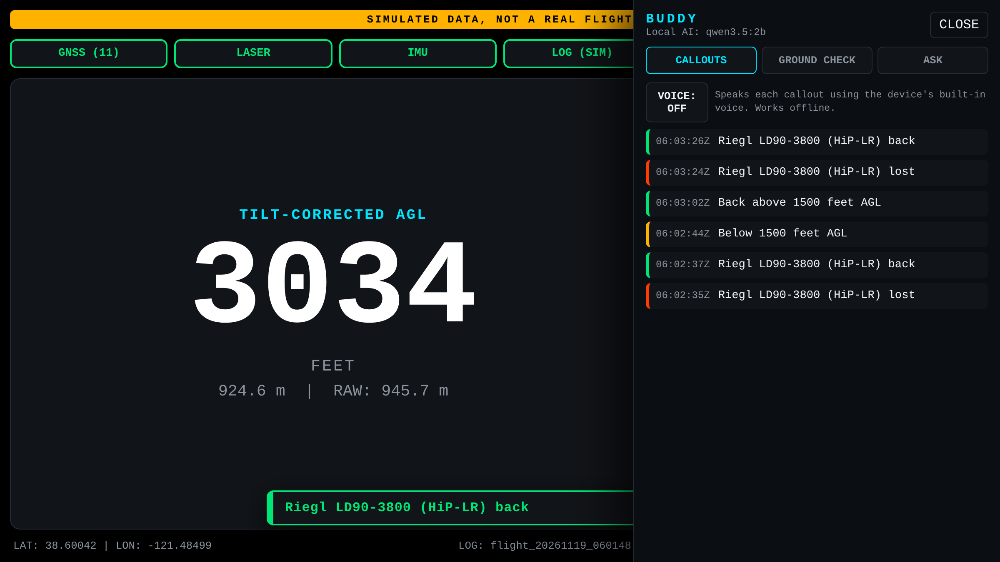 | 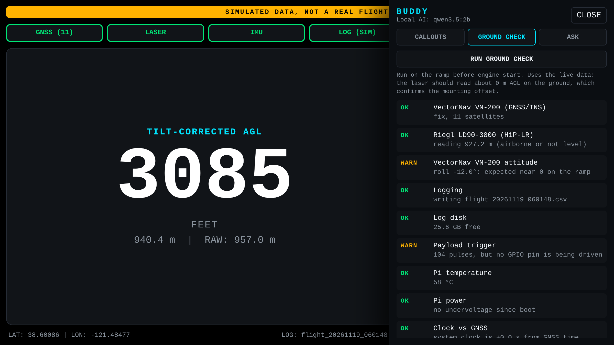 | 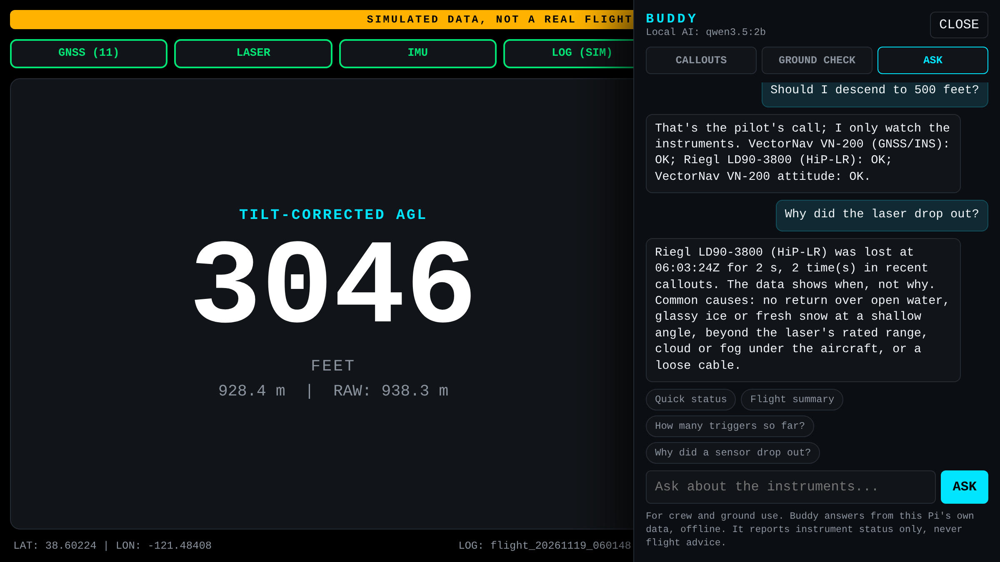 |

- **Callouts** pop up at the bottom of the display and go in a log (also saved to the flight database). Turn on **VOICE** and the iPad or phone speaks them with its built-in voice, offline. Buddy calls out:
  - a sensor lost, or back;
  - the GNSS fix lost, or fewer than 6 satellites;
  - crossing the low-AGL line;
  - logging stopped, or logging to the SD card because the SSD isn't mounted;
  - the log disk filling up;
  - the payload trigger stalling;
  - the Pi running hot (80 °C or more) or undervolted.
- **Ground check** is a preflight list built from live data. With the aircraft on the ramp, the laser should read about 0 m AGL; if it doesn't, the mounting offset is wrong. It also checks:
  - GNSS fix and satellites;
  - attitude near level;
  - logging target and disk space;
  - trigger pulses;
  - Pi temperature and power;
  - the Pi's clock against GNSS time.
- **Ask** answers questions about the instruments.
  - **Instant answers.** Common questions (status, flight summary, trigger count, AGL, fix, logging, "why did the laser drop out?") get an instant answer from the data.
  - **Facts, not guesses.** A dropout answer says when it happened and for how long. The data doesn't say why, so likely causes are listed only as possibilities.
  - **No flight advice.** Anything that sounds like flight advice gets "that's the pilot's call" and the instrument status.
  - **Local AI.** Other questions go to a local model if you installed one during setup.

**About the AI:** it runs on the Pi's CPU through [Ollama](https://ollama.com), fully offline, with `qwen3.5:2b` as the suggested model for an 8 GB Pi 5.

- **Speed:** expect answers in tens of seconds, not instantly.
- **Quality:** the answers are plain.
- **Accuracy:** a small model can still be wrong.

Buddy is meant for the ground and for crew. A solo pilot should not be typing in flight; the spoken callouts are the in-flight part.

## Accuracy: testing and calibration

A number on the display is only useful if you know when to trust it. AeroLab-Pi checks at four points.

### 1. Every boot: self-test

Runs once the sensors have had about 8 seconds to start talking. The results appear on the startup screen and in **Buddy → Checks**, and are saved with the flight record. It checks:

- **Configuration:** drivers are known, ports exist, no port is used twice, the mounting offset is sane, and the laser's rated range covers the planned survey height.
- **Log storage:** writes 4 KB, fsyncs, reads it back and compares. This proves the disk really takes data.
- **Each sensor:** data rate against the device's expected rate, the percentage of bad frames (checksum failures point at a wrong baud rate or bad wiring), and plausible values (range above 0 and inside the laser's rating, attitude within ±90°, position valid).
- **The rest:** clock against GNSS time, trigger pulses, and whether this installation has been calibrated.

### 2. Every new flight: ground calibration

**Buddy → Calibrate**, with the aircraft parked on firm ground, engine off, for 30 seconds. Enter the attitude the aircraft really sits at, from an inclinometer on the cabin floor or seat rails (0/0 if level), and optionally the field elevation.

| Measured | How | Limit |
|---|---|---|
| Laser mounting offset | True AGL is 0 on the ground, so the vertical laser range is the offset. Median of the samples, so a person walking under the laser doesn't move it | noise ≤ 10 cm |
| Attitude sensor bias | Average roll and pitch minus the inclinometer reference: how crooked the sensor is mounted | noise ≤ 0.3°, bias > 5° flagged |
| GNSS | Position scatter of the parked antenna, satellites, HDOP | ≤ 3 m RMS, ≥ 6 satellites, HDOP ≤ 2.5 |
| GNSS altitude | Against the field elevation plus antenna height (optional) | ±15 m |
| Clock, trigger | Offset from GNSS time, pulses during the capture | ≤ 1 s, > 0 |

Apply saves the corrections to `config/calibration.local.json` (git-ignored) and uses them from then on. **Start new flight** creates a flight record that snapshots the calibration and settings, and reruns the self-test.

### 3. In flight, every second

- **Laser spike gate.** Each range is turned into a vertical height using the attitude at that moment, and rejected if it jumps more than 5 m or 5% from the last good one: birds, cloud, multipath. Three in a row are a real step (a cliff or crevasse) and are accepted. Raw ranges are always logged.
- **AGL is computed only when a laser sample arrives,** paired with the current attitude. In a bank the slant range changes tens of metres per second, so pairing a new attitude with an old range would add metres of error.
- **AGL quality.** Past 20° off vertical (configurable `hud.max_tilt_deg`) the tilt correction depends on the ground being flat under a wider footprint, so the display marks AGL "less reliable". Within 5% of the laser's rated range it says "near max range".
- **Monitors and callouts.** Per-sensor data rate and bad-frame rate, HDOP, GNSS position jumps, and heading against GNSS track in straight flight (a steady difference is wind crab or heading error). Callouts fire only once a change has held for 3 seconds, so a survey with many banks doesn't spam them.
- **Geotags.** Each trigger is logged at the position extrapolated to that instant (last fix + ground speed × age). The raw fix and each sensor's sample age are kept too, so processing can redo it. With a 5 Hz GNSS at 55 m/s this cuts geotag error from about 9 m to under 1 m (see below). AeroLab-Pi also asks u-blox receivers for 5 Hz when it opens the port.

### 4. After a flight: laser boresight

A laser tilted 1° from the aircraft's down axis costs about 4.5 m of AGL at 20° of bank at 700 m, and no ground test can see it. Fly a few minutes over flat ground (lake ice, an ice shelf, a big field) with banks of 15 to 25° both ways, then:

```bash
python tools/boresight.py            # latest flight
python tools/boresight.py --apply    # save it
```

It fits the tilt that makes laser height track GNSS altitude through the banks, so climbs don't matter. Pitch boresight is fitted only if pitch varied by 4° or more.

### Proof: virtual flights

`tools/virtual_flight.py` runs the real daemon, as a separate process exactly as the service does, against simulated sensors on virtual serial ports. The sensors speak each device's actual protocol (NMEA, VectorNav, Benewake, BNO08x, LightWare binary, Riegl, MAVLink). The simulated installation has deliberate errors:

- IMU bias of +0.8° roll and −0.5° pitch;
- a laser mounted 0.62 m up while 0.40 m was entered by hand;
- a 1° laser boresight;
- 2% corrupted frames, 1% laser spikes and 3 cm of laser noise.

Each run calibrates on the ground, flies a survey leg with ±20° banks, and scores everything logged against the truth. Results for every profile ([docs/accuracy.md](docs/accuracy.md)):

| Profile | Offset found (true 0.62 m) | IMU bias found (true +0.80/−0.50°) | Boresight found (true 1.00°) | AGL error p95 | Geotag error p95, last fix → extrapolated |
|---|---|---|---|---|---|
| Snow survey (Riegl, VN-200) at 686 m | 0.619 m | +0.80/−0.51° | +0.98° | 1.18 m (0.17%) | 1.4 → 0.7 m |
| Budget (TF03, F9P, BNO085) at 122 m | 0.621 m | +0.80/−0.50° | +1.00° | 0.06 m | 8.8 → 0.7 m |
| Mid-range (GRF-500, VN-100) at 305 m | 0.6 m (0.1 m steps) | +0.80/−0.50° | +0.92° | 1.07 m | 8.2 → 0.7 m |
| Flight controller (MAVLink) at 91 m | 0.621 m | +0.80/−0.50° | +1.02° | 0.10 m | 10.9 → 0.8 m |
| Generic serial at 152 m | 0.619 m | +0.80/−0.50° | +1.00° | 0.23 m | 3.6 → 0.8 m |

What's left at survey height is mostly timing: the attitude used is up to one sample (25 ms at 40 Hz) older than the laser reading, which matters at 7°/s of roll. Simulation shows the software does what it should; only flight tests over known flat ground show that a given installation does.

**Error budget, for planning.** AGL error from an attitude error δ at bank φ is about h·tan(φ)·δ. At 700 m and 20° of bank that is 4.5 m per degree; level, it is under 0.1 m per degree. Keep the survey legs level and calibrate the boresight.

## Try it on a laptop (no hardware)

Needs Python 3.10 or newer.

```bash
git clone https://github.com/craigm26/aerolab-pi.git
cd aerolab-pi
python3 -m venv .venv
.venv/bin/pip install -r requirements.txt
.venv/bin/python scripts/configure.py --defaults --sim   # snow survey profile, simulated
.venv/bin/python daemon/main.py
```

Open <http://localhost:8000>. Set `sim: faults: true` in `config/sensors.local.yaml` to make the simulated laser drop out now and then, so the callouts show. Sim logs go to `logs/sim/` and never mix with flight logs.

## Install on the Raspberry Pi

Target: Raspberry Pi OS (Bookworm or newer). The Pi 5 is the main target, and any Pi from the 3B+ up should work.

```bash
git clone https://github.com/craigm26/aerolab-pi.git
cd aerolab-pi
./install.sh             # asks setup questions with menus
# or
./install.sh --sim       # no questions; snow survey profile, simulated sensors
./install.sh --defaults  # no questions; snow survey profile, real sensors
```

### Setup menus

`./install.sh` asks its questions with arrow-key menus, the same kind `raspi-config` uses:

| Start from a profile | Pick each device | Laser range check | Payloads |
|---|---|---|---|
| 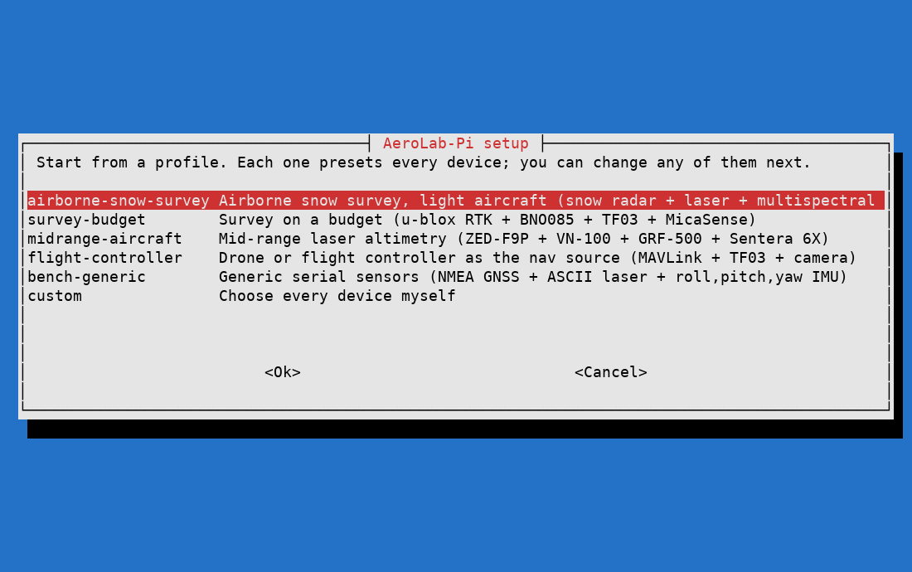 | 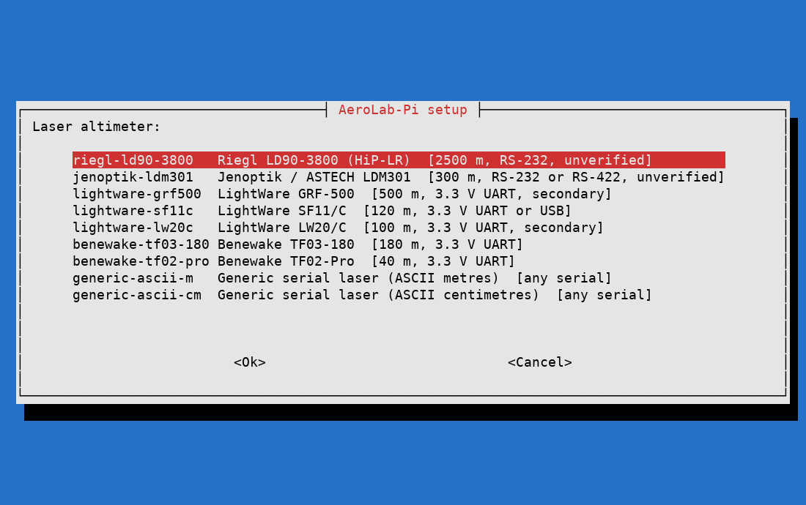 | 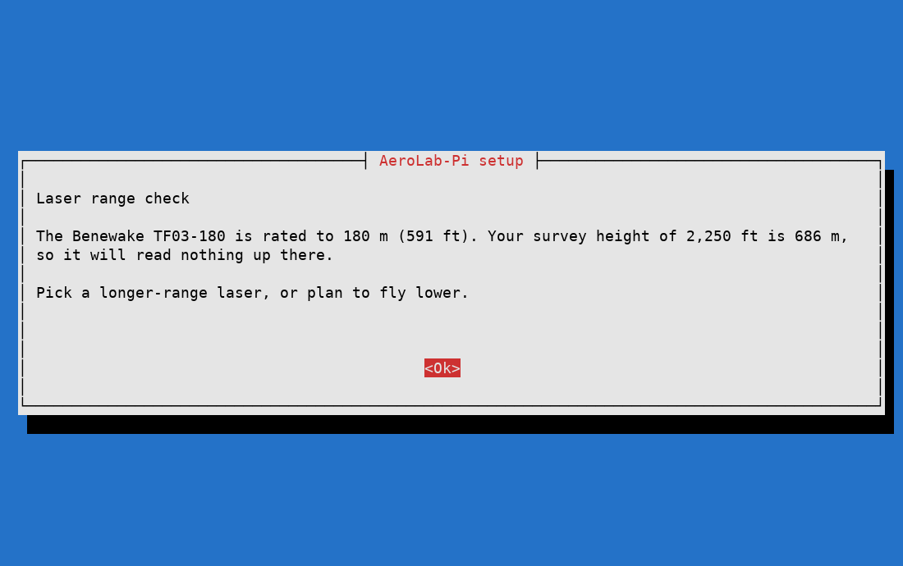 | 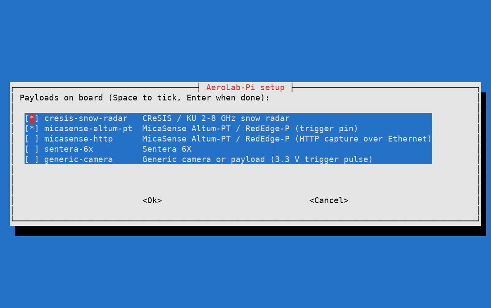 |

It goes through, in order:

1. **Mode:** live sensors or simulation.
2. **Profile:** a starting setup, preselected to the airborne snow survey.
3. **Devices:** GNSS/INS, attitude source and laser, each defaulted from the profile.
4. **Ports:** the serial port for each device, picked from the ports plugged in at that moment. USB adapters are saved by their stable `/dev/serial/by-id/` names. Baud and protocol come from the preset.
5. **Mounting offset** of the laser.
6. **Survey height,** with the laser range check.
7. **Payloads** checklist. The trigger pulse width and polarity come from the cameras chosen, then you pick the pin and rate.
8. **SSD mount, low-AGL warning and display port.**
9. **Buddy's AI model:** none, `qwen3.5:2b`, `qwen3.5:4b`, or one already installed.
10. **Hotspot:** whether to make the Pi a Wi-Fi hotspot. The default is no, because it drops a Wi-Fi SSH session.

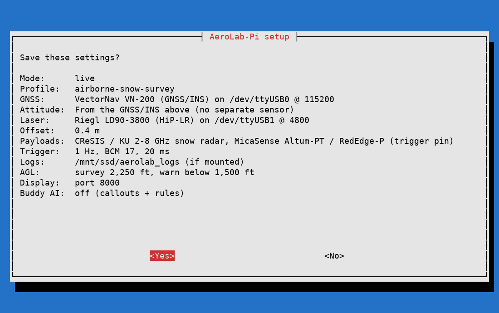

The answers go to `config/sensors.local.yaml`, which git ignores, so `git pull` never overwrites them. Change them any time with `./configure.sh`, which shows the same menus and then restarts the service. Plug the sensors in before running it so they show up in the lists.

### What the installer does

1. Installs Python and the GPIO libraries (`gpiozero` + `lgpio`, which work on the Pi 5; `RPi.GPIO` does not).
2. Creates `.venv` and installs the requirements.
3. Adds your user to the `dialout` and `gpio` groups.
4. Frees the hardware UART for a 3.3 V sensor (serial console off, serial port on).
5. Asks the setup questions.
6. Adds what the chosen hardware needs: `pymavlink` for a MAVLink flight controller, and Ollama plus the model if you chose Buddy AI (downloaded once, needs internet at install time).
7. Installs and starts the `aerolab` systemd service, which starts on boot and restarts within 2 seconds if it stops.

Reboot once afterwards so the serial and group changes take effect. Then:

```bash
journalctl -u aerolab -f       # live log: which ports opened, any sensor errors
curl localhost:8000/api/state  # current numbers as JSON
```

To update later: `git pull && ./install.sh`.

## Wiring

The Pi's pins are 3.3 V. A device listed as RS-232 or RS-422 needs a USB-RS232/RS422 adapter, never a direct wire to the Pi's pins. That includes the Riegl, the LDM301, VectorNav port 1, SBG Port A and Applanix. 3.3 V UART devices (u-blox, TF03, GRF-500, BNO085) can use the Pi's UART on pins 8 (TX) and 10 (RX).

| Thing | Where |
|---|---|
| 3.3 V UART sensor | GPIO 14/15 (pins 8/10), `/dev/serial0` |
| USB or USB-serial adapters | any USB port; saved by `/dev/serial/by-id/` name |
| Payload trigger | BCM 17 (pin 11) by default; any free pin from the setup menu |
| Ground | join the payload's signal ground to a Pi ground pin |

Measure `mounting_offset_m`: the vertical distance from the laser lens down to the lowest point of the aircraft. On the ground the display, and the Buddy ground check, should read 0.

For any device not in the catalog, set `driver`, `port` and `baud` by hand in `config/sensors.local.yaml`. The drivers are listed at the bottom of `daemon/drivers.py`. Sensors that answer on demand take `poll` and `poll_hz`; sensors that need a wake-up command take `init`.

## Before flight

1. **Logs on a USB SSD.** Mount it at `/mnt/ssd` (or the path you gave setup) in `/etc/fstab` with `nofail`. The daemon logs there only when it is really mounted; otherwise it logs to `./logs` on the SD card, and Buddy calls that out.
2. **Wi-Fi hotspot** for the cockpit display. `./configure.sh` can create it. Then open `http://10.42.0.1:8000` on the iPad. "Add to Home Screen" gives a full-screen display.
3. **Ground check** in the Buddy panel, on the ramp.
4. **Read-only SD card, last.** Once everything works, turn on the overlay filesystem (`sudo raspi-config` → Performance Options → Overlay File System) so a hard power switch can't corrupt the SD card. Anything written to the SD card is then lost at power-off, so the SSD is required. Turn the overlay off before `git pull` or `./install.sh`.

## Aircraft safety

- **Power isolation.** Run the Pi and payload from their own LiFePO4 pack or an isolated, fused DC-DC converter. Never splice into the aircraft's avionics bus. Buddy's undervoltage callout is a backstop, not a substitute.
- **Not avionics.** See the note at the top.

## Data

Everything sits in the log directory.

- `aerolab_flight.db`, table `telemetry`: every sample at `log_hz` (5 Hz default), including per-sensor health flags.
- `aerolab_flight.db`, table `payload_triggers`: one row per trigger pulse. `trigger_id` restarts at 1 every boot; `session_start` tells boots apart.
- `aerolab_flight.db`, table `events`: every Buddy callout.
- `aerolab_flight.db`, table `flights`: one row per boot or **Start new flight**, with the calibration, settings and self-test results at that moment.
- Telemetry also keeps `laser_used_m` (after the spike gate), `agl_quality`, the raw attitude before calibration, `hdop`, ground speed and track, and both the extrapolated position (`lat`, `lon`) and the last fix (`fix_lat`, `fix_lon`, `gnss_age_ms`). Trigger rows keep the same, plus each sensor's sample age at the trigger.
- `flight_YYYYMMDD_HHMMSS.csv`: the same samples as `telemetry`, one file per 5 minutes, times in UTC.

The Pi has no battery-backed clock unless a coin cell is fitted (Pi 5), so without internet the system time can be wrong at boot. Buddy's ground check compares the clock with GNSS time and warns when they differ by more than a second. Setting the clock from GNSS is not done yet.

A VectorNav GNSS/INS reports height above the ellipsoid, not sea level. The display labels it HAE.

## Development

```bash
.venv/bin/pip install -r requirements-dev.txt
.venv/bin/python -m pytest -m "not slow"     # 82 tests, about 7 s
.venv/bin/python -m pytest                   # plus 2 end-to-end virtual flights, about 2 min
python tools/virtual_flight.py               # every profile, with a full report
```

The tests cover:

- **Drivers.** Byte frames are built from each vendor's protocol description. The VectorNav checksum is checked against the manual's own example line, and the LightWare CRC against the standard check value.
- **Setup.** Every profile, in live and sim mode, produces a config the daemon accepts.
- **Buddy.** The callout rules and their edges, the ground check, and the instant answers.
- **The AGL maths.**
- **A short simulated flight,** end to end.
- **Geometry.** The AGL formula is checked against an independent rotation-matrix derivation at 500 random attitudes.
- **Integrity.** The spike gate (no lag, real steps accepted), data rate, bad frames and sample age, GNSS jumps, the heading check, the storage test, config checks, and callout debouncing.
- **Calibration.** Recovery of the offset and bias despite spikes and noise, the inclinometer reference, grading, persistence, and the boresight fit with and without GNSS altitude.
- **Virtual flights** with pass limits: calibration recovered, boresight within 0.15°, AGL p95 under 0.5% of height, extrapolated geotags under 2 m, and the self-test catching the corrupted frames.

`tools/` holds the virtual-flight harness and simulated sensors, the boresight tool, and the scripts that made the screenshots, GIFs and demo video from the running code.
